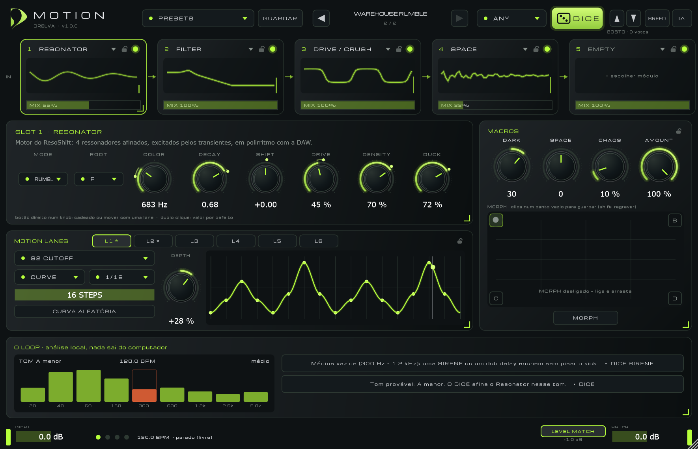

# Motion · Drelva

Rack de efeitos para techno hipnótico, raw e industrial onde tudo se mexe, sincronizado com a DAW.
DICE até gostar, volta atrás, cruza dois sons, ou descreve o som em texto.

**Página, demo interativa no browser, áudio e guia: https://mordf0kas.github.io/motion**

**Download (Windows, VST3 + Standalone):** [Releases](https://github.com/mordf0kas/motion/releases/latest)

## Instalar

1. Descarrega `Motion-1.0.1-Windows.zip` em [Releases](https://github.com/mordf0kas/motion/releases/latest) e extrai.
2. Copia a pasta `Motion.vst3` para `C:\Program Files\Common Files\VST3\`.
3. Na DAW, volta a procurar plugins. Põe o Motion num canal de drums ou num loop e carrega em **DICE**.

O ficheiro não está assinado: o SmartScreen pode avisar ("Mais informações ▸ Executar mesmo assim").

Este repositório contém a página pública (GitHub Pages) e os binários. A demo web é um port do motor em JavaScript (AudioWorklet).
